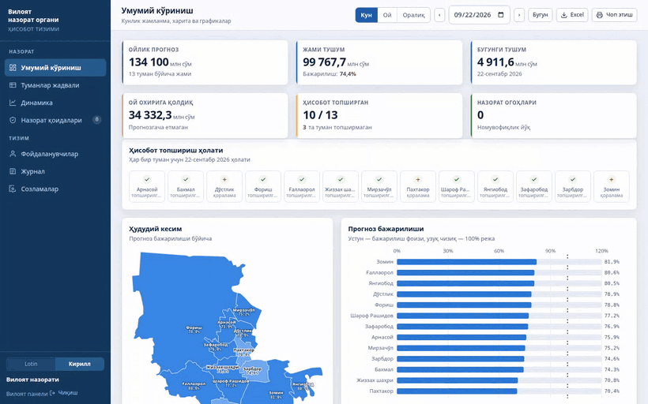
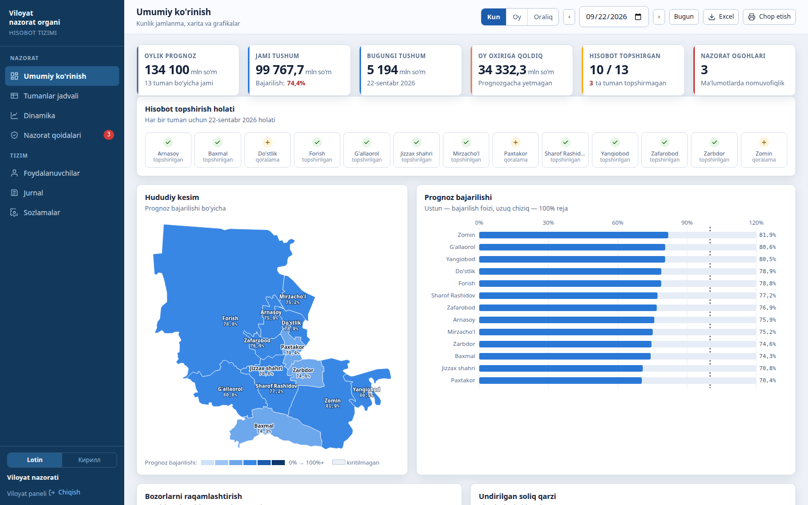
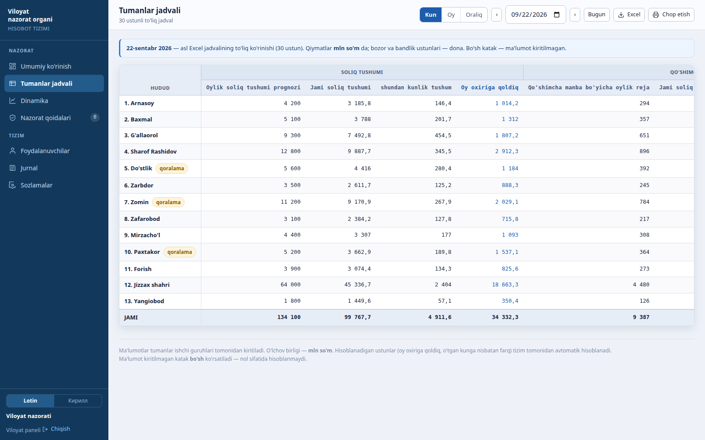
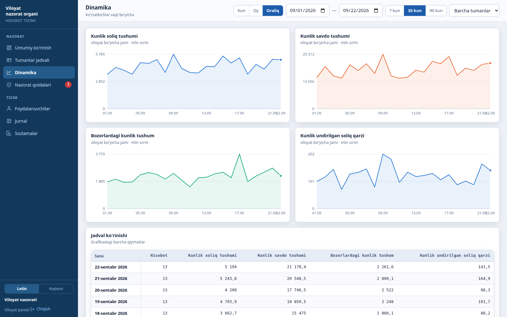
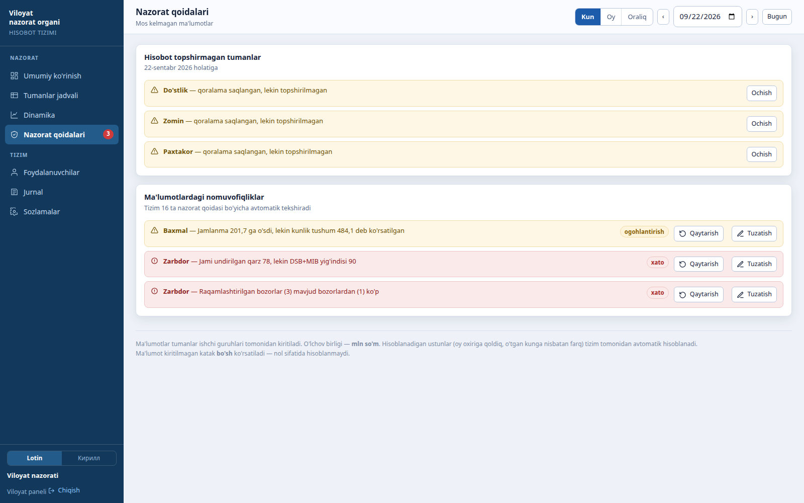
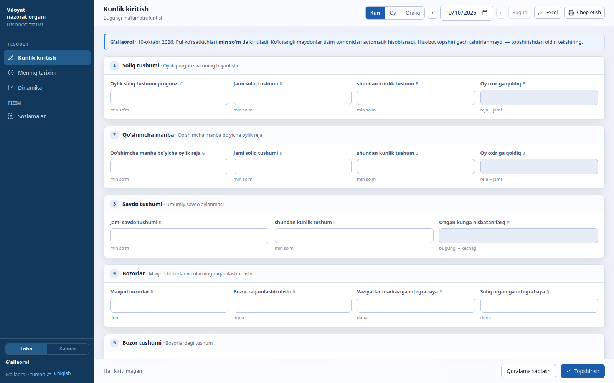
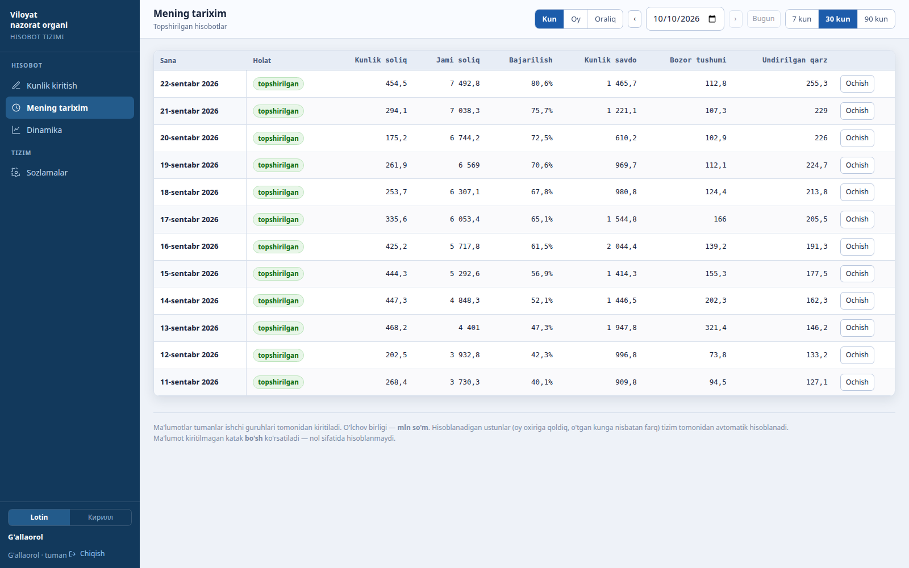
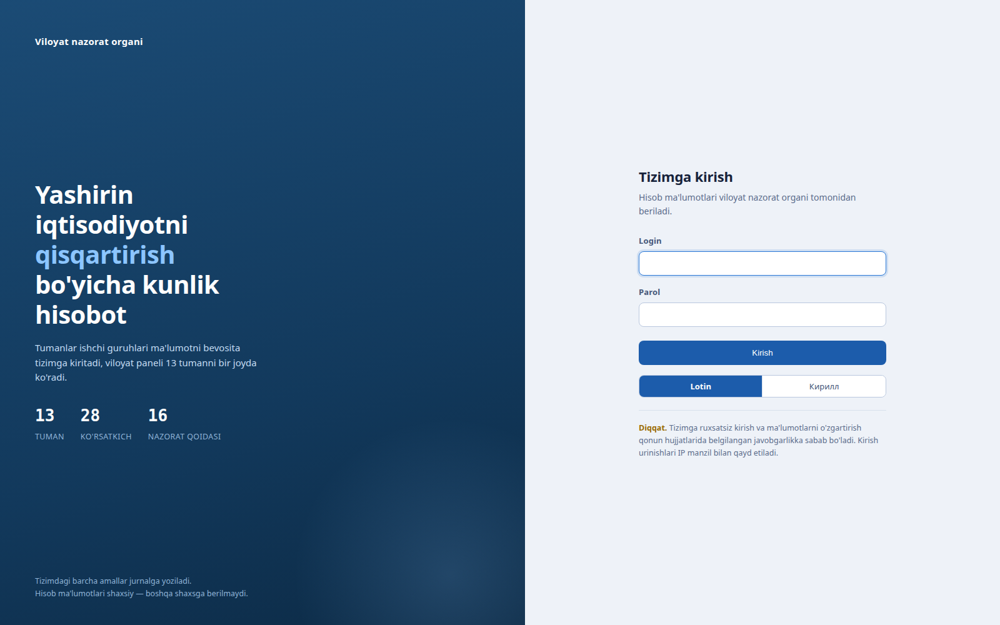
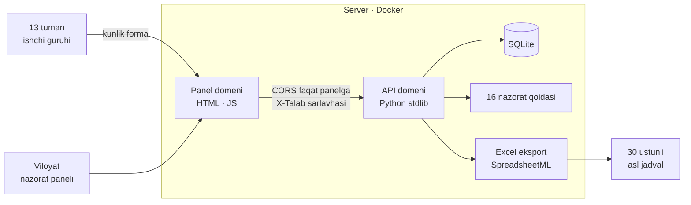

**Viloyatning 13 tumanidan kunlik hisobot yig'adigan tizim:** har tuman o'z ma'lumotini kiritadi, viloyat paneli hammasini bir joyda ko'radi. Nomuvofiq raqamlarni 16 ta qoida avtomatik topadi, jadval esa asl 30 ustunli Excel shaklida yuklab olinadi.

---

## Qanday ishlaydi

Ilgari tumanlar hisobotni Excel faylda yuborardi, viloyatda kimdir ularni qo'lda bitta jadvalga yig'ardi. Endi:

1. **Tuman** o'z kabinetiga kirib, kunlik ko'rsatkichlarni formaga yozadi. Qoralama saqlanadi, tayyor bo'lgach «Topshirish» bosiladi.
2. **Tizim** hisoblanadigan ustunlarni (oy oxiriga qoldiq, kechagiga nisbatan farq) o'zi to'ldiradi va 16 ta nazorat qoidasini tekshiradi.
3. **Viloyat** paneli 13 tumanni xaritada, jadvalda va grafiklarda ko'radi. Kim topshirmagani, qaysi raqam mos kelmagani darhol ko'rinadi.
4. **Excel** tugmasi asl 30 ustunli jadvalni aynan o'sha tuzilishda chiqaradi: sarlavha, uch qatorli shapka, 13 tuman va JAMI qatori.

## Asosiy imkoniyatlar

| | |
|---|---|
| 🧾 **28 ko'rsatkich** | 24 tasini tuman kiritadi, 4 tasini tizim hisoblaydi. Soliq tushumi, qo'shimcha manba, savdo, bozorlar va ularni raqamlashtirish, yangi ish o'rinlari, undirilgan qarz |
| 📅 **Kun · Oy · Oraliq** | Har ko'rsatkichning o'z jamlash qoidasi bor: kunlik oqim qo'shiladi, oy boshidan jamlanma esa davrdagi oxirgi qiymat bo'yicha olinadi. Aks holda 30 kunlik jamlanma 30 barobar shishib ketardi |
| 🛡️ **16 nazorat qoidasi** | Yig'indi mosligi (jami = DSB + MIB), kunlik qiymat jamlanmadan oshmasligi, jamlanma kamaymasligi, o'sish kunlik tushumga mosligi. Qoidalar hisobotni **to'smaydi**: tuman baribir topshiradi, nomuvofiqlik viloyat panelida va jurnalda qoladi |
| ↩️ **Qaytarish va tuzatish** | Viloyat yopilgan hisobotni sababini yozib tumanga qaytaradi yoki shoshilinch holatda o'zi tuzatadi. Eski qiymat saqlanadi. Tuman o'z hisobotini 3 kun orqagacha tahrir qila oladi (sozlamada o'zgaradi) |
| 🗺️ **Xarita va grafiklar** | Tumanlar prognoz bajarilishi bo'yicha bo'yaladi. Kiritilmagan tuman shtrixlanadi va raqami ko'rsatilmaydi (0 emas). Har grafik yonida jadval ko'rinishi ham bor |
| 🔤 **Lotin va kirill** | Matn dasturda faqat lotinda yoziladi, kirill avtomatik o'giriladi. Tanlangan yozuv Excel eksportiga ham o'tadi |
| 👥 **Ikki rol** | Tuman faqat o'zinikini kiritadi va ko'radi. Viloyat kiritmaydi, faqat ko'radi, qaytaradi va hisoblarni boshqaradi |
| 🔐 **Xavfsizlik** | Parollar PBKDF2-SHA256 (200 000 aylanma). Imzoli sessiya parol almashganda bekor bo'ladi. Kirishga urinishlar IP bo'yicha cheklanadi, CSRF uchun maxsus sarlavha talab qilinadi, CSP inline skriptga nonce bilan ruxsat beradi. Har amal jurnalga yoziladi |

## Ekranlar

<table>
<tr>
<td width="50%"> <b>Umumiy ko'rinish</b> — prognoz, tushum, topshirish holati, xarita</td>
<td width="50%"> <b>Tumanlar jadvali</b> — asl Excel'ning 30 ustunli to'liq ko'rinishi</td>
</tr>
<tr>
<td> <b>Dinamika</b> — ixtiyoriy oraliq, tuman bo'yicha filtr</td>
<td> <b>Nazorat qoidalari</b> — topshirmaganlar va nomuvofiq raqamlar</td>
</tr>
<tr>
<td> <b>Tuman: kunlik kiritish</b> — bloklarga bo'lingan forma, qoralama va topshirish</td>
<td> <b>Tuman: mening tarixim</b> — topshirilgan hisobotlar</td>
</tr>
<tr>
<td colspan="2"> <b>Kirish</b> — lotin/kirill tanlovi, ruxsatsiz kirish haqida ogohlantirish</td>
</tr>
</table>

> Suratlardagi barcha raqamlar **namuna ma'lumot**: tasodifiy urug' bilan yasalgan, haqiqiy hisobotlarga aloqasi yo'q.

## Arxitektura

- **Tashqi kutubxonasiz:** server faqat Python standart kutubxonasida, panel freymvorksiz JavaScript va SVG xarita.
- **Ikki domen, bitta sessiya:** panel va ma'lumot so'rovlari alohida domenda. Cookie umumiy domenga beriladi, API boshqa manbadan kelgan so'rovga javob bermaydi.
- **O'rnatish skripti:** `ORNATISH.sh` Docker'ni o'rnatadi, DNS yozuvini tekshiradi, serverda boshqa Caddy ishlayotgan bo'lsa unga ulanadi va boshqa saytlarga tegmaydi. SSL'ni Caddy o'zi oladi.

## Sifat

Avtomatik sinovlar to'plami yo'q. Suratlar mahalliy nusxada, namuna bazada ishga tushirib olindi. Ikkala rol bilan barcha sahifalar ochildi, brauzerda JS xatosi chiqmadi.

## Texnologiyalar

Python 3 (stdlib `http.server`, `sqlite3`, `hashlib`) · SQLite · vanilla JavaScript + SVG · SpreadsheetML 2003 (Excel) · Docker + Caddy

## Jonli

🌐 [soliq.geonazorat.uz](https://soliq.geonazorat.uz) — xizmat kirishi (hisoblar viloyat tomonidan beriladi)

---

**Manba kodi yopiq.** Namoyish yoki hamkorlik bo'yicha: Telegram [@Humoyun_Davronov](https://t.me/Humoyun_Davronov)

Muallif — Humoyun Davronov

